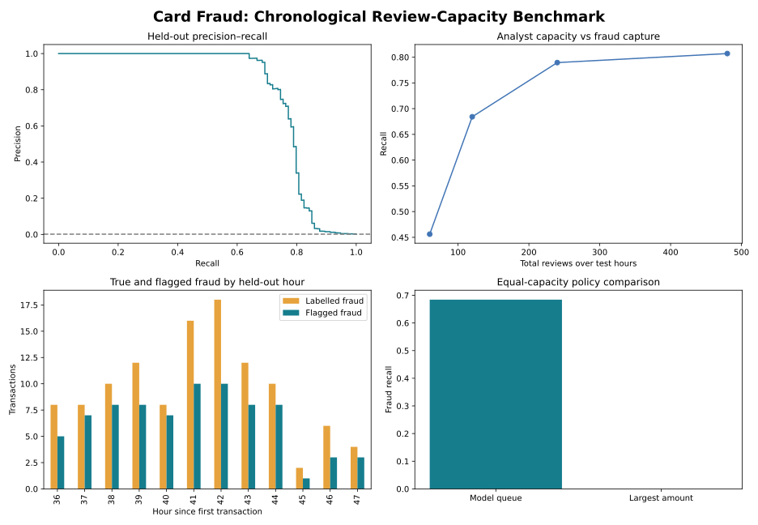

# Card Fraud Monitoring and Analyst Triage in Python

**How much labelled card fraud can a model identify in a later period under a fixed analyst-review budget?**

Independent banking portfolio research using public historical data. Created with AI assistance; not an employer implementation or a claim of production deployment.



## Measured result

Later-period average precision **0.782**. At **10 reviews per hour**, the queue flags **78 of 114** test frauds: **68.4% recall** and **65.0% precision**, across **120 reviews**.

Read [findings and recommendations](reports/FINDINGS.md), [full metrics](reports/metrics.json) and the supporting CSV reports. Figures are generated by running the committed Python analysis.

## What makes this more than a classifier demo

- Full public benchmark ingestion with checksum verification and explicit exact-event deduplication.
- Chronological train, calibration, validation and test windows with one-hour gaps.
- Training-only preprocessing; class-weighted logistic regression versus histogram gradient boosting.
- Separate probability calibration and validation-based model selection.
- Precision–recall metrics, score-distribution PSI and hour-block uncertainty intervals.
- Strict 5/10/20/40-review-per-hour replay policies, deterministic tie-breaking and an equal-capacity largest-amount baseline.
- Explicit comparison between a fixed probability threshold and a hard-capacity queue.
- Hourly monitoring tables, aggregate fraud amount capture and local unlabelled transaction replay.
- Validation-set permutation importance with PCA interpretability limits.
- Automated policy, temporal-gap and output-reconciliation checks.

## Reproduce

Python 3.12 was used. Run from this repository's root:

```bash
python -m venv .venv
# macOS/Linux
source .venv/bin/activate
# Windows PowerShell: .venv\Scripts\Activate.ps1
python -m pip install -r requirements.txt
python download_data.py
python run.py
python -m unittest discover -s tests -v
```

The download is approximately 151 MB. Raw input, generated estimators and row-level predictions remain in ignored `data/` and `artifacts/` folders. `reports/` contains published aggregate results, figures and the methodological audit. Dependency versions are pinned.

## Batch research scoring

After training locally:

```bash
python score_transactions.py path/to/transactions.csv --capacity 10
```

The scorer uses the locally generated `artifacts/model.joblib`, preserves preprocessing and calibration, and requires the input schema described in [MODEL_CARD.md](docs/MODEL_CARD.md). It writes research outputs; it does not approve/decline credit, block transactions, or contact customers. Use only estimator files you generated locally; joblib files are executable serialised Python objects.

## Repository guide

| Path | Purpose |
| --- | --- |
| `run.py` | End-to-end experiment and report generation |
| `banklab/` | Reusable statistical helpers and strict-capacity queue policy |
| `download_data.py` | Public dataset acquisition and checksum validation |
| `reports/` | Measured aggregate results and charts |
| `tests/` | 6 meaningful feature/policy and completed-run checks |
| `docs/` | Data provenance, model card and experiment protocol |
| `.github/workflows/verify.yml` | Fresh download, training and tests in CI |

## Interpretation limits

This is offline **card-fraud** research, not an AML system or a deployed real-time engine. Only about two days are observed. Card/customer identifiers, delayed chargeback timing and original PCA feature definitions are unavailable. Source PCA was prepared upstream; this project cannot prove its original preprocessing was fitted without future information. A one-hour gap does not reproduce realistic label availability. Hourly top-K reviews occur after the hour closes and may require up to one hour of batching latency. Flagged amount is not prevented loss.

## Sources and licence

Worldline and the Machine Learning Group, Université Libre de Bruxelles. Credit Card Fraud Detection dataset, originally published via Kaggle.

See [DATA_SOURCE.md](docs/DATA_SOURCE.md) for source URLs, original terms, provenance and changes. Code is [MIT licensed](LICENSE); data rights are separate.
